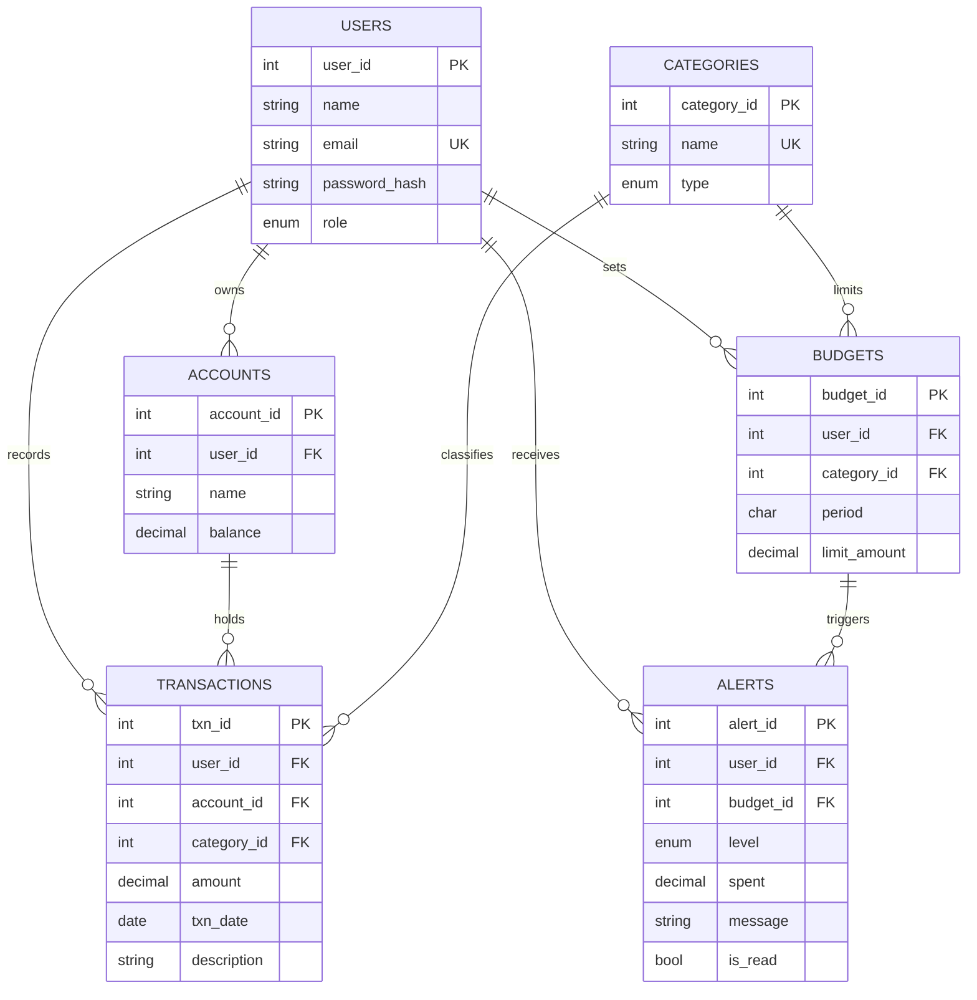

# SpendSense: Project Documentation

## 1. Problem statement
People rarely notice overspending until the month is over. Spreadsheets do not warn them, and most trackers only list transactions. SpendSense records income and expenses, compares them with monthly category budgets, and raises alerts the moment spending approaches or crosses a limit.

## 2. Objectives
- Record income and expenses across multiple accounts with guaranteed consistent balances.
- Let users set monthly budgets per category and alert them automatically at 80% and 100%.
- Show category summaries, month-over-month comparison and unusually large expenses.
- Keep an append-only audit trail and activity analytics for administrators.

## 3. Scope
In scope: authentication, two roles (user, admin), accounts, transfers, transactions, budgets, alerts, analytics, audit logs. Out of scope: bank integrations, multi-currency, mobile app.

## 4. Functional requirements
| ID | Requirement |
|---|---|
| F1 | Register, log in, log out; passwords hashed |
| F2 | Users manage accounts and transfer money atomically |
| F3 | Users add, edit, delete, search and filter transactions |
| F4 | Users set budgets per expense category and month |
| F5 | System creates warning (80%) and exceeded (100%) alerts automatically |
| F6 | Dashboard: balance, income, spending, category breakdown, month-over-month, anomalies |
| F7 | Admin manages categories and user roles |
| F8 | Admin views audit log and activity analytics |

## 5. ER diagram


## 6. Relational schema
- users(**user_id**, name, email, password_hash, role, created_at)
- accounts(**account_id**, user_id→users, name, balance, created_at); UNIQUE(user_id, name)
- categories(**category_id**, name, type)
- transactions(**txn_id**, user_id→users, account_id→accounts, category_id→categories, amount, txn_date, description, created_at)
- budgets(**budget_id**, user_id→users, category_id→categories, period, limit_amount); UNIQUE(user_id, category_id, period)
- alerts(**alert_id**, user_id→users, budget_id→budgets, level, spent, message, is_read, created_at); UNIQUE(budget_id, level)

All tables are in 3NF: every non-key attribute depends only on the key. Category names are not repeated in transactions, and alert amounts are snapshots by design.

## 7. Database choice and justification
| Data | Database | Why |
|---|---|---|
| Users, accounts, transactions, budgets, alerts | **MySQL** | Money needs ACID transactions, foreign keys, CHECK constraints, and triggers that keep balances and alerts consistent. Data is highly relational (joins and aggregates). |
| Audit logs, activity events | **MongoDB** | Append-only, write-heavy, and the shape varies by entity (before/after payloads differ for transactions, budgets, users). A TTL index expires old events automatically. Aggregation pipelines suit analytics. |

Failure handling: MongoDB writes are fire-and-forget with an in-memory retry queue, so a MongoDB outage never blocks or rolls back a financial operation.

## 8. Data dictionary
| Table | Column | Type | Constraints |
|---|---|---|---|
| users | email | VARCHAR(120) | UNIQUE, NOT NULL, CHECK format |
| users | role | ENUM(user, admin) | NOT NULL, default user |
| accounts | balance | DECIMAL(12,2) | CHECK ≥ 0 |
| categories | type | ENUM(income, expense) | NOT NULL |
| transactions | amount | DECIMAL(12,2) | CHECK > 0 |
| transactions | txn_date | DATE | NOT NULL |
| budgets | period | CHAR(7) | CHECK format YYYY-MM |
| budgets | limit_amount | DECIMAL(12,2) | CHECK > 0 |
| alerts | level | ENUM(warning, exceeded) | UNIQUE with budget_id |

MongoDB collections
- `audit_logs`: `{user_id, action, entity, entity_id, before, after, ts}`. Index `{user_id:1, ts:-1}`.
- `activity_events`: `{user_id, action, meta, ts}`. Indexes `{ts:1}` with TTL 90 days, `{action:1, ts:-1}`.

## 9. Implementation summary (see `db/schema.sql`)
- **DDL**: CREATE with PK/FK/UNIQUE/CHECK, composite indexes, FULLTEXT index; ALTER and DROP shown in `db/demo_queries.sql`.
- **Triggers**: `trg_txn_after_insert/update/delete` keep account balances in sync and call `sp_check_budget`.
- **Stored procedures**: `sp_check_budget` (alert logic), `sp_monthly_report`.
- **Views**: `v_monthly_category_summary`, `v_budget_status`.
- **Transactions**: account transfer uses BEGIN, `SELECT ... FOR UPDATE`, two UPDATEs, COMMIT or ROLLBACK.
- **Indexing**: `(user_id, txn_date)` and `(user_id, category_id, txn_date)`; compare with `EXPLAIN` in `demo_queries.sql`.
- **Full-text search**: `MATCH(description) AGAINST(... IN BOOLEAN MODE)` with a LIKE fallback.
- **NoSQL aggregation**: `$match`, `$group`, `$sort`, `$limit`, `$dateToString` in `app/api/admin/route.js`.

Advanced concepts demonstrated: transactions, triggers, stored procedures, views, indexing, full-text search, window functions, NoSQL aggregation (8, requirement is 4).

## 10. Important queries
- Budget status: view `v_budget_status` (JOIN, LEFT JOIN, GROUP BY, CASE).
- Month-over-month: `LAG(expense) OVER (ORDER BY period)` over a grouped subquery.
- Anomalies: join with a subquery `AVG(amount) ... HAVING COUNT(*) >= 4`, filter `amount > 2 * avg`.
- Search: FULLTEXT + LIKE with filters by category, type and date range.

## 11. System architecture
```
Browser (Next.js pages, React)
   │  fetch /api/*  (HttpOnly JWT cookie)
Next.js middleware (auth + admin gate)
   │
Route Handlers (validation, role checks)
   ├── MySQL  (mysql2 pool, parameterized SQL, triggers/procedures/views)
   └── MongoDB (audit + activity, fire-and-forget)
```

## 12. Roles
- **User**: own accounts, transactions, budgets, alerts, dashboard.
- **Admin**: everything above plus categories, user roles, audit log, analytics.

## 13. Test cases
| # | Test | Expected |
|---|---|---|
| T1 | Register with weak password | Rejected with message |
| T2 | Log in with wrong password | 401, generic message |
| T3 | Open /dashboard while signed out | Redirect to /login |
| T4 | User opens /admin | Redirect to /dashboard |
| T5 | Add expense taking Food to 80% of budget | `warning` alert created, message shown |
| T6 | Add expense taking a category past 100% | `exceeded` alert created |
| T7 | Add expense larger than account balance | Rejected by CHECK, nothing saved |
| T8 | Transfer more than source balance | Rolled back, both balances unchanged |
| T9 | Edit/delete a transaction | Account balance adjusts via trigger |
| T10 | Raise a budget limit | Alerts for it reset and are re-evaluated |
| T11 | Delete a category in use | Rejected (FK RESTRICT) |
| T12 | Stop MongoDB, add a transaction | Transaction still succeeds; log is retried later |

Verified in development: T2, T3, T4, T5, T6, T7, T8, T12 against MySQL 8.0 via the HTTP API.

## 14. Screenshots
Add screenshots of: login, dashboard, transactions, budgets, alerts, accounts, admin (analytics, audit, users, categories).

## 15. Conclusion and future enhancements
SpendSense shows how relational integrity (MySQL) and flexible logging (MongoDB) complement each other. Future work: recurring transactions via a scheduled procedure, CSV export, email or push notifications for alerts, semantic search over transaction descriptions with pgvector or Chroma, and multi-currency support.
